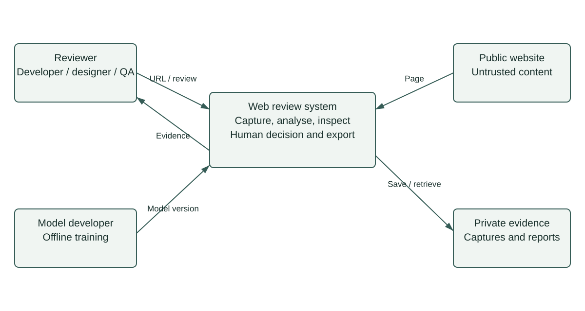

# System context

The reviewer submits an approved public page and receives evidence for a human decision. Target websites are external, untrusted data sources. The model developer supplies versioned artefacts from an offline workflow.

The proposed first deployment is a local pilot operated by the team. A public multi-user service and production hosting are outside the first milestone. Capture isolation remains necessary when running locally.

- FR01–FR06 support review. FR07–FR08 support data and model development.
- The demonstration uses synthetic fixtures, not live website captures.
