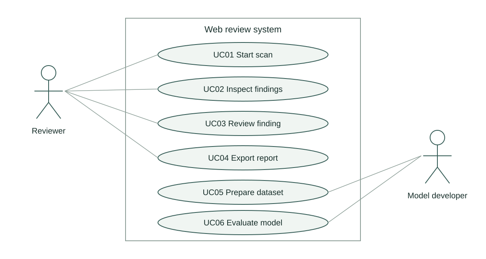

# Use cases

The reviewer starts a scan, checks progress, inspects evidence, records a judgement and exports a report. Invalid or unsupported targets lead to an explicit error. A retry creates a new scan.

The model developer prepares labelled data, evaluates models and publishes a versioned inference artefact. Supervision and peer review are project activities rather than application use cases.

- UC01 Start scan includes validation. UC02 Inspect findings requires completed analysis.
- UC03 Review preserves model output. UC04 Export includes the reviewer state.
- UC05 Prepare dataset and UC06 Evaluate model implement FR07–FR08.
