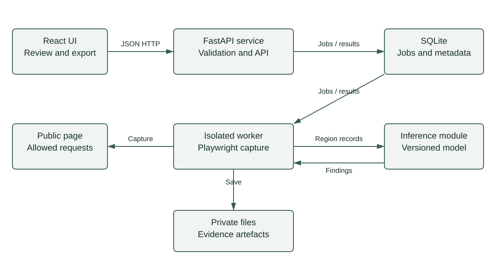

# Component architecture

The React interface calls FastAPI using JSON HTTP. The API validates targets and creates jobs in a persistent SQLite table. A local worker claims jobs, captures an isolated page and calls the inference module with normalised region records.

The pilot uses one worker and one API instance. Claim jobs atomically, use leases and bounded retries, and recover expired leases or mark jobs failed after restart. A dedicated queue and shared database can follow if deployment needs expand.

Private files store evidence; SQLite stores metadata and references. Inference returns supported labels, scores and evidence links. Model training runs offline.

